# Field Service Management App

A comprehensive, cross-platform Field Service Management solution built with **Flutter**. This application streamlines the workflow between customers needing repairs, technicians executing the jobs, and administrators overseeing the operations. 

## 📱 Features by Role

### 👨‍💼 Admin Portal
* **Dashboard**: Overview of all ongoing field operations.
* **Job Monitoring**: Track service requests and technician locations in real-time.
* **Technician Management**: Assign jobs, monitor availability, and track performance.
* **Customer Management**: View customer profiles and service histories.
* **Reports & Analytics**: Generate insights on completed jobs, revenue, and efficiency.

### 👷‍♂️ Technician App
* **Task Management**: Accept, update, and complete assigned service tasks.
* **Live Mapping**: Navigate to customer locations with integrated maps.
* **Offline Mode**: Work seamlessly in areas with poor connectivity; data syncs automatically when back online.
* **Task Details**: Access comprehensive job requirements, history, and customer notes.

### 👤 Customer App
* **Service Requests**: Easily request electrical, plumbing, appliance repair, and other services.
* **Request Tracking**: Monitor the live status of active service requests.
* **Profile Management**: Update contact details and service addresses.

## 🛠️ Tech Stack & Architecture

* **Framework**: [Flutter](https://flutter.dev/) (Dart)
* **State Management**: `provider` 
* **Routing**: `go_router`
* **Dependency Injection**: `get_it` (Service Locator Pattern)
* **Backend / Database**: [Supabase](https://supabase.com/) (PostgreSQL & Authentication)
* **API / Networking**: REST APIs using `http`, connectivity checks via `connectivity_plus` and `internet_connection_checker_plus`
* **Local Storage / Offline Sync**: `sqflite` (SQLite) and `shared_preferences`
* **Location & Mapping**: `flutter_map` (OpenStreetMap integration), `geolocator`, and `geocoding`
* **Environment Management**: `flutter_dotenv`

## 📸 Screenshots

Here is a glimpse of the application interfaces across Admin, Technician, and Customer portals:

<div align="center">

### 👨‍💼 Admin Portal
  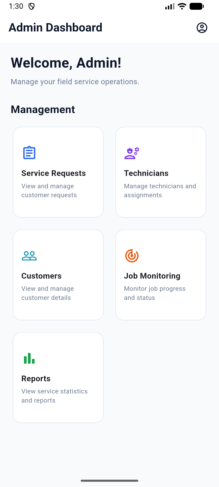
  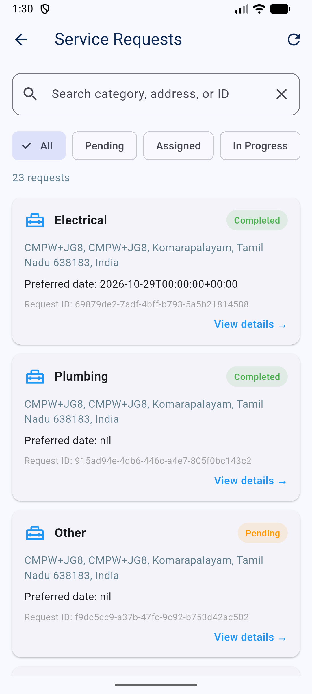
  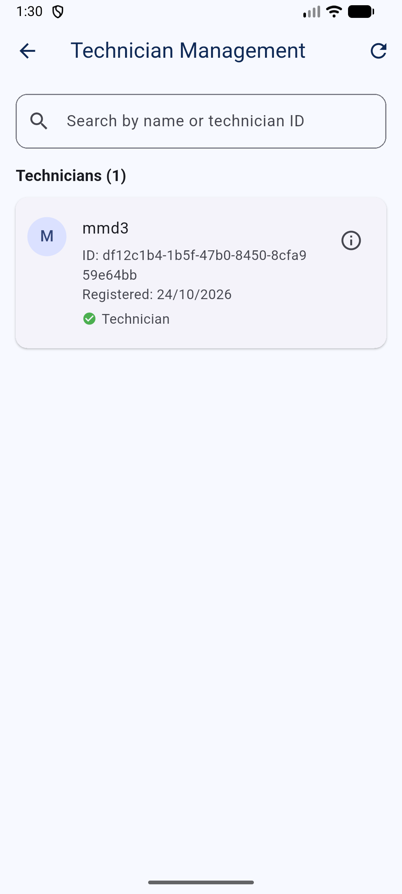
  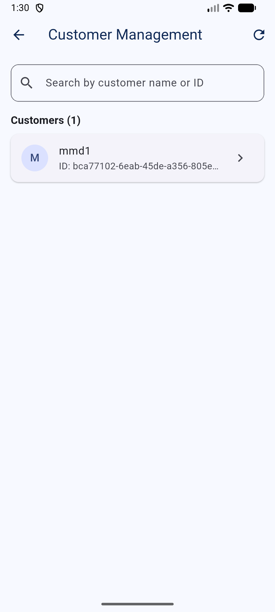
  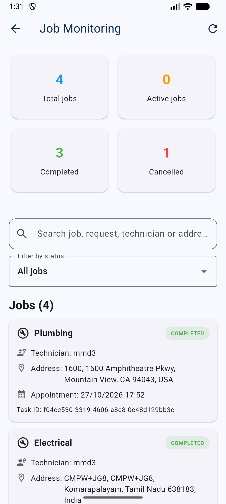
  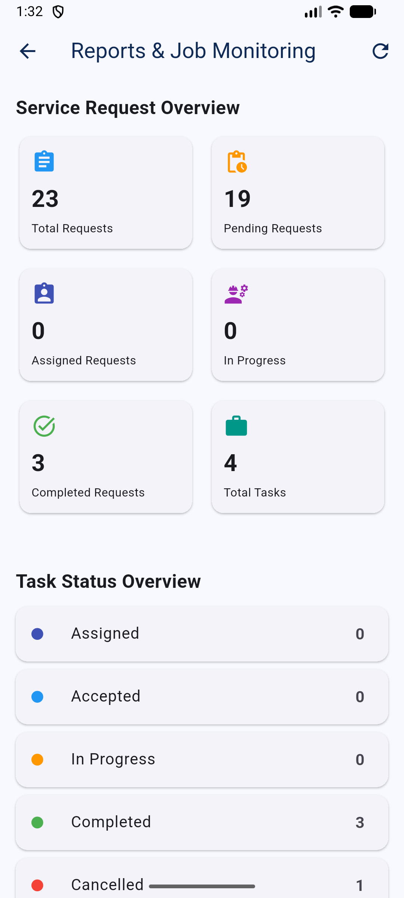

### 👷‍♂️ Technician App
  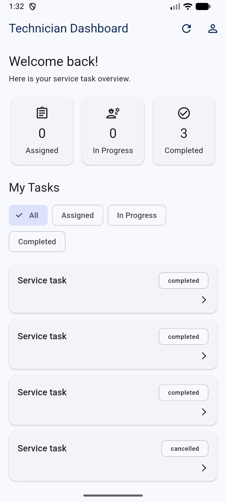
  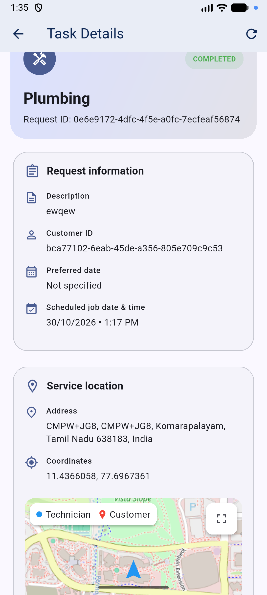
  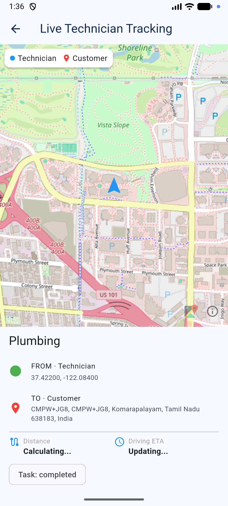
  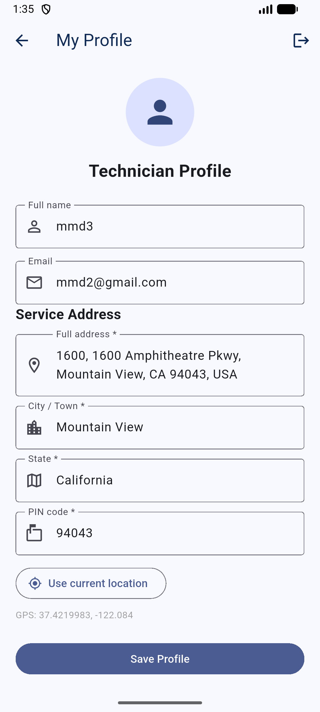

### 👤 Customer App
  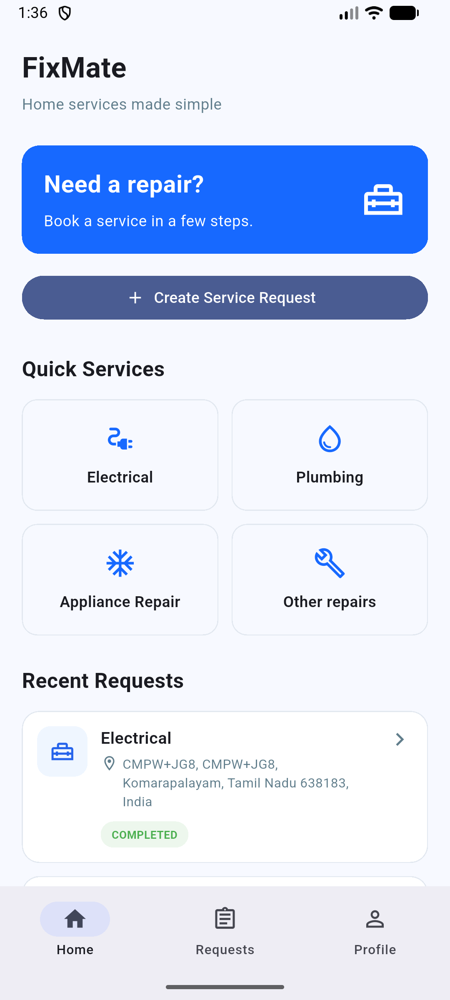
  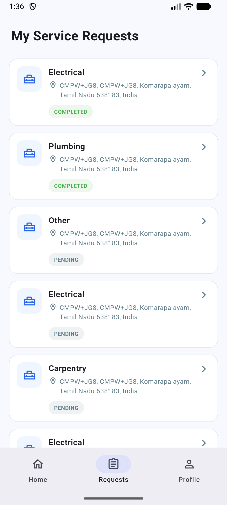
  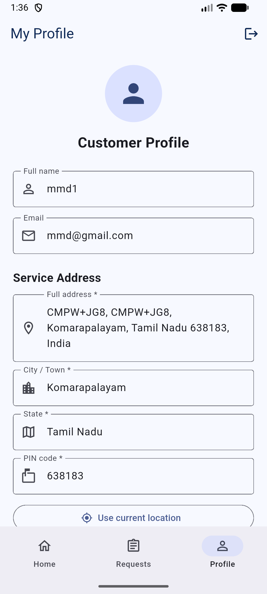

</div>

## 🚀 Getting Started

### Prerequisites
* Flutter SDK (latest stable version)
* Supabase Account (for backend services)

### Installation

1. **Clone the repository:**
   ```bash
   git clone <your-repo-url>
   cd field_service
   ```

2. **Install Dependencies:**
   ```bash
   flutter pub get
   ```

3. **Configure Environment:**
   Ensure your Supabase URL and Anon Key are correctly configured in your initialization file (`main.dart` or `.env` depending on your setup).

4. **Run the App:**
   ```bash
   flutter run
   ```

## 📄 License

This project is licensed under the MIT License.
